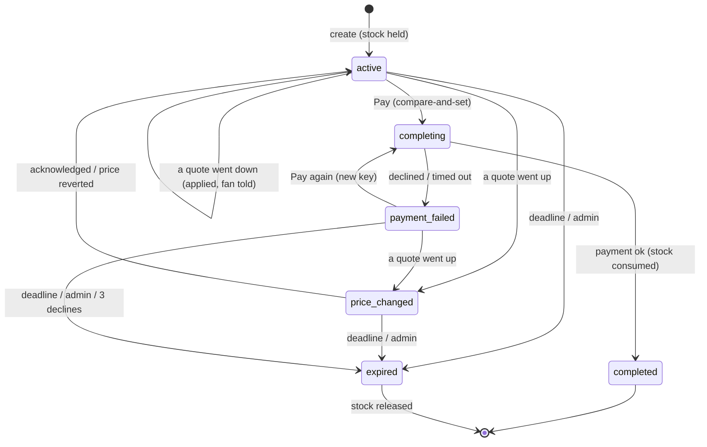

# Checkout continuity

[](https://github.com/TomMahle/checkout-continuity/actions/workflows/ci.yml)
[](packages/checkout/src)

Fans switch devices mid-checkout: they start on a laptop, then finish on a
phone. This prototype makes one checkout **session** that either device can
pick up, without double orders, without holding stock forever, and without
hiding a price increase.

- [What was built](#what-was-built) and [how to run it](#run-it)
- [The session state model](#the-session-state-model)
- [How web and mobile resume the same session](#how-web-and-mobile-resume-the-same-session)
- [Stale inventory, price changes, duplicate completion](#the-three-hard-cases)
- [What renders before hydration](#what-renders-before-hydration)
- [Instrumentation](#instrumentation)
- [Tradeoffs](#tradeoffs) and [what I'd do with more time](#with-more-time)

## What was built

| Piece      | Where                                   | Notes                                                                                                                                                   |
| ---------- | --------------------------------------- | ------------------------------------------------------------------------------------------------------------------------------------------------------- |
| Domain     | `packages/checkout/src`                 | State machine (server-only, `@continuity/checkout/store`), schemas, countdown math, API client. Pure TypeScript, in-memory, injected clock/payment/ids. |
| API        | `apps/web/src/app/api`                  | Route handlers: thin adapters (parse with zod, call the store, return the result).                                                                      |
| Web        | `apps/web/src/app/checkout`             | `/checkout` (tickets), `/checkout/[id]` (the session), `/checkout/admin` (levers and the event log).                                                    |
| Mobile     | `apps/mobile/src/app/checkout/[id].tsx` | Opens from `continuity://checkout/<id>`. Same session, same API client.                                                                                 |
| Unit tests | `packages/checkout/src/*.test.ts`       | Every transition, lazy expiry, stale totals and versions, idempotency, races, timeouts.                                                                 |
| E2E tests  | `apps/web/e2e/checkout.spec.ts`         | Desktop + phone contexts, admin edits, slow payment, API races, no-JS first response, axe.                                                              |

Payment, inventory and the catalog are stubs behind small interfaces
(`PaymentGateway`, `Analytics`, the store's catalog methods). Everything is
in memory, so a server restart forgets all sessions.

## Run it

Requirements: Node 24 (see `.nvmrc`) and pnpm 10 (`corepack enable` picks up the
version pinned in `package.json`). Everything runs locally; see
[Tradeoffs](#tradeoffs) for why there is no hosted deployment.

Repository layout: a pnpm + Turborepo monorepo with `packages/checkout`
(the domain), `apps/web` (Next.js: API and web pages) and `apps/mobile`
(Expo).

```bash
pnpm install

# Web (http://localhost:3000/checkout). Hold length defaults to 10s;
# a longer hold is easier to demo:
CHECKOUT_HOLD_TTL_MS=60000 pnpm dev

# Mobile. The app reaches the web server at Metro's host (your computer's
# network address) on port 3000; EXPO_PUBLIC_API_URL overrides it.
pnpm dev:mobile
# QR codes and links on the checkout page use your computer's network address
# even when the page is open at localhost, so a phone can follow them.
# CHECKOUT_PUBLIC_ORIGIN overrides it (e.g. behind a tunnel).
# In Expo Go, scan the checkout page's first QR code ("Scan with Expo Go").

# Tests
pnpm --filter @continuity/checkout test:run        # unit tests
pnpm --filter @continuity/web exec playwright install chromium   # once
pnpm test:e2e                                    # builds the web app, runs all browser tests
pnpm check                                       # types, lint, unit tests, formatting
```

A demo, with two browser windows (one narrowed to a phone width) or a phone:

1. `/checkout`, press **Buy**. A 10s hold starts (set the TTL for longer).
2. Open the same URL on the second device, or scan the QR code.
3. In `/checkout/admin`, raise that ticket's price: both devices say which
   ticket changed and from what to what, and Pay is disabled until one of them
   accepts the new price.
4. Press **Pay (slow, 3s)** on one device: the other shows "Payment pending"
   and cannot pay; both land on the same order number.
5. Press **Expire now** in the admin (or just wait): both show "expired", and
   **Start over** creates a fresh session.

Environment knobs (all optional): `CHECKOUT_HOLD_TTL_MS` (10000),
`CHECKOUT_COMPLETING_TIMEOUT_MS` (15000), `CHECKOUT_SLOW_PAYMENT_MS` (3000),
`CHECKOUT_PUBLIC_ORIGIN` (the origin used in the QR code),
`CHECKOUT_EXPO_GO_ORIGIN` (the Metro address for the Expo Go link; defaults to
`exp://<page hostname>:8081` outside production, and is hidden in production
unless set).

## The session state model



| Status           | Meaning                                                      | Pay allowed | Holds stock |
| ---------------- | ------------------------------------------------------------ | ----------- | ----------- |
| `active`         | Quoted prices match the catalog; deadline not passed         | yes         | yes         |
| `price_changed`  | At least one quote went **up** (or a decrease came with one) | no          | yes         |
| `completing`     | One payment attempt is in flight                             | no          | yes         |
| `completed`      | Paid. Terminal                                               | no          | consumed    |
| `payment_failed` | The last attempt was declined or timed out. Retryable        | yes         | yes         |
| `expired`        | Deadline passed, admin ended it, or 3 declines. Terminal     | no          | released    |

`Session` holds `items` (a **snapshot** of ticket id, name and quoted price
taken at creation), `status`, `version`, `expiresAt`, `orderId?`,
`failureReason?` and `attempts` (idempotency key to stored result). Clients
get a `SessionSnapshot` that adds `serverNow`, the total, and which tickets
changed price. All prices are integer cents.

Rules worth knowing:

- **Holds are never extended by activity.** `expiresAt` is fixed at creation;
  accepting a price or retrying a card doesn't buy more time.
- **A payment that has started may finish after the deadline.** The stock is
  already ours; expiring mid-charge would take the fan's money and give the
  ticket away. Expiry only applies to `active`, `price_changed` and
  `payment_failed`.
- **`completing` times out** (15s). A crashed or hung attempt becomes
  `payment_failed` (`payment_timeout`), so the session can't wedge. If that
  old attempt answers later with a success, the charge is refunded through the
  gateway instead of being lost or double-applied.
- **`expired` also covers "gave up"**: `failureReason` says why
  (`hold_expired`, `admin_expired`, `too_many_payment_failures`).
- **Paying takes the total the client showed; accepting a price takes the
  `version` it saw.** A mismatch is a 409 carrying the current snapshot, so
  the client just re-renders. Version is bumped on every status or quote
  change, but paying only cares whether the amount moved: a decline in
  another window doesn't make this one confirm anything.

### Lazy expiry

Nothing runs on a timer. Every read and write first **settles** the session
against the clock and the catalog (`refresh` in `store.ts`): expire if overdue,
time out a stuck `completing`, detect price changes. Reading the _catalog_
(`listTickets`, `getTicket`, and creating a session) first settles every
session, so an abandoned hold returns its stock the moment anyone looks at
that ticket's availability. The server-sent-events stream looks once a second,
which is what makes a lapsed deadline show up on a device with no traffic.

The clock is injected (`Clock`) and can be advanced by an admin, so tests and
demos never wait.

## How web and mobile resume the same session

A session is an id. Resuming is "fetch the snapshot for that id", from
anywhere:

- **Web:** `https://<host>/checkout/<id>`. The page shows a QR code and a
  copy-link button for this URL.
- **App:** `continuity://checkout/<id>` (the `continuity` scheme is registered in
  `apps/mobile/app.json`; expo-router maps it to `src/app/checkout/[id].tsx`).
  The page also shows a QR code and copy button for it.
- **Expo Go (development):** Expo Go doesn't register the `continuity` scheme,
  so that link only works in a development or store build. In Expo Go the same
  route is `exp://<metro host>:<port>/--/checkout/<id>`. Outside production
  the page shows this link first, assuming Metro runs on the same machine as
  the web server on its default port 8081 and is reached at the same hostname
  as the page. Set `CHECKOUT_EXPO_GO_ORIGIN` (the address Metro prints) when
  that assumption doesn't hold. Known issue: if Expo Go isn't already running,
  the link opens the app on Home; opening it a second time reaches the
  checkout.

Both surfaces use one API and one client (`createCheckoutClient`), so they
parse and interpret responses identically. There is no per-device cart and no
sync: the server is the only source of truth, and every client simply
re-renders the latest snapshot.

Staying current after the first load:

| Trigger                                | Web                                                    | Mobile                      |
| -------------------------------------- | ------------------------------------------------------ | --------------------------- |
| Other device changes the session       | Server-sent events (`/events`)                         | Same                        |
| Tab / app comes back to the foreground | `visibilitychange` and `pageshow` refetch              | `AppState` `active` refetch |
| Countdown reaches zero                 | Refetch (retry every 1s) - never decides expiry itself | Same                        |
| Any 409                                | Render the snapshot that came with it                  | Same                        |

Both surfaces run the same hook, `useCheckoutSession` from
`@continuity/checkout/react`; each only supplies its foreground signal. Server-
sent events are read over `fetch` rather than `EventSource`, because React
Native has none: a fetch whose body streams is enough (the browser's own on
the web, `expo/fetch` in the app), and the reader reconnects with backoff. A
suspended app always loses its stream, so coming back to the foreground both
refetches and reconnects at once.

### The countdown clock

Phone clocks are wrong and jump. The countdown therefore never uses
`Date.now()`:

1. Every snapshot includes `expiresAt` and `serverNow` (both server epoch ms).
2. The client records `t0 = performance.now()` before the request and
   `t1` after the response, and **anchors** `serverNow` to the request's
   midpoint: `anchor = (t0 + t1) / 2`. Splitting the round trip evenly cancels
   most of the network latency.
3. Remaining time is `expiresAt - (serverNow + (performance.now() - anchor))`.
   `performance.now()` is monotonic, so wall-clock changes can't move it.
4. At zero the client **refetches** instead of declaring expiry. Only the
   server decides a hold is over (clock skew, a payment that started just
   before the deadline).
5. Pay is disabled for the last second so a press can't race the deadline.

After server rendering there is no anchor yet (the HTML is a few hundred ms
old). The island therefore renders `expiresAt - serverNow` from the snapshot
(identical on server and client, so no hydration mismatch), then refetches
immediately after mount and ticks from that properly anchored response. The
math is `packages/checkout/src/countdown.ts`, shared by web and mobile.

## The three hard cases

### Stale inventory

Creating a session **decrements** the ticket's `available` (one unit per
item). The unit comes back when the session expires or gives up; it is
consumed (not returned) on completion. Because expiry is lazy, the catalog
read described above releases overdue holds first, so a second fan never sees
"sold out" because of someone else's abandoned tab. Admin stock edits set
`available` directly (units neither sold nor held). Tests: expiry returns
stock; reading only the ticket releases it; completion is not "un-consumed"
by later expiry; a sold-out create holds nothing.

### Price changes

Each cart item stores `quotedPriceCents`. On every read the session compares
each quote with the live catalog, **per ticket**:

- **Increase** (any ticket): status becomes `price_changed`, Pay is disabled,
  and both web and app show _which_ ticket moved and `old → new`. The fan
  accepts with an explicit action (a button on web, a native `Alert` plus a
  button on mobile). Accepting re-quotes every changed item, returns to
  `active`, bumps the version, and does not extend the deadline.
- **Decrease only:** the lower price is applied immediately, the version is
  bumped and an inline "a price dropped" notice shows. It doesn't block.
- **Reverted before acknowledgement:** back to `active` on its own.
- **Server enforcement:** `complete` refuses unless the status is payable, so a
  stale client can't pay an old price: a total other than the current one is
  `total_changed`, and a `price_changed` session is `price_not_acknowledged`.

### Duplicate completion

Two different guards, doing two different jobs:

| Guard               | Protects against                                             | How                                                                                                                                                                                                                                                   |
| ------------------- | ------------------------------------------------------------ | ----------------------------------------------------------------------------------------------------------------------------------------------------------------------------------------------------------------------------------------------------- |
| **Idempotency key** | The same press sent twice (retry, double tap, flaky network) | One key per payment attempt: minted on the first Pay press, reused by every press and retry, replaced after any definitive answer. The server stores the result per key and replays it; a repeat while the first is in flight joins the same attempt. |
| **Compare-and-set** | Two different presses (laptop and phone)                     | `active -> completing` is checked and set with no `await` between, so exactly one request wins. The other gets a 409 (`payment_in_progress` / `already_completed`) with the snapshot.                                                                 |

The key alone wouldn't stop the second device (different key); the CAS alone
wouldn't make a network retry safe (the retry would look like a second
device). Together: a retried press returns the original order, and a second
device's press is refused and then sees the winner's result.

A payment _failure_ is also stored under its key, so retrying the same attempt
doesn't hammer the card; a new attempt gets a new key.

## What renders before hydration

`/checkout/[id]` is a server component. The first response, with JavaScript
off (an e2e test proves it), already contains:

- the event, each price, the total, the status;
- price-change, expired, payment-pending and payment-failed banners;
- the remaining hold time (as of the response);
- both QR codes, drawn on the server as inline SVG (`uqr`), so no QR library
  is shipped to the browser.

`CheckoutLive` is a client component, so Next also server-renders it into that
HTML. After hydration it adds the live parts: ticking countdown, SSE, the
visibility refetch, and working Pay buttons. Until then the buttons are
rendered **disabled** (an unhydrated button can't do anything, and a disabled
one says so). Only these ship as client JS: the live panel and the copy
buttons. Starting and restarting a checkout use a server action on a plain
`<form>`, so **Buy** and **Start over** work before hydration too.

Things deliberately _not_ done at render time: opening the event stream
(after mount), reading `Date.now()` or `performance.now()` during render
(hydration mismatches), and trusting the SSR timer (anchored by a refetch).

Unknown session ids get a real `404` from `src/proxy.ts`, before any
rendering. With Cache Components the root layout is a static shell that starts
streaming (committing to a `200`) before the page runs, so a `notFound()` in
the page could only send a "soft 404" whose layout React then rebuilds in the
browser. The page keeps its `notFound()` as a fallback.

## Instrumentation

(This is not necessary, but looks useful enough for debugging that I'll keep it around)

The in-memory event log (`/api/admin/state`, shown on the admin page) records
the funnel, each event with session id, surface (`web`, `mobile_web`, `app`),
and data:

| Event                                             | When                                                                                                                                             |
| ------------------------------------------------- | ------------------------------------------------------------------------------------------------------------------------------------------------ |
| `session_created`                                 | A session starts (`surface` = where)                                                                                                             |
| `session_resumed`                                 | A page load / deep link by a surface that isn't the creator (`cross_device: true`), or the creator returning after > 5s; `age_ms` since creation |
| `price_change_shown`                              | A surface was shown a price change (once per surface and change)                                                                                 |
| `price_change_accepted`                           | The fan acknowledged                                                                                                                             |
| `expired_seen`                                    | A surface saw the expired state                                                                                                                  |
| `completion_attempted` / `_succeeded` / `_failed` | Payment funnel; failures carry the reason                                                                                                        |
| `duplicate_blocked`                               | A second press was refused or replayed (reason in data)                                                                                          |

To measure whether this actually helps, I'd randomize **per user** (not per
session or device, or one fan could see both arms) into control (no resume
link / session is device-bound) and treatment, and attach the `arm` to every
event. The primary metric is checkout conversion for sessions that were
**cross-device** (`session_resumed.cross_device`) versus single-device, in
both arms, plus completion rate after `price_change_shown` and after
`expired_seen` (does Start over recover them?). Guardrails: duplicate orders
(must be zero), time-to-pay, `payment_failed` rate, and `duplicate_blocked`
volume (a spike means a UX problem, not an attack). Event schemas are the
`AnalyticsEvent` type; `Analytics` is an interface so a real pipeline swaps in.

## API

All bodies are validated with zod schemas from `@continuity/checkout`. Every
response that concerns a session carries its snapshot, including errors.

| Method and path                                                                         | Purpose                                      |
| --------------------------------------------------------------------------------------- | -------------------------------------------- |
| `GET /api/tickets`                                                                      | Live catalog (settles overdue holds first)   |
| `POST /api/sessions` `{ticketId, surface}`                                              | Create a session, hold stock. 409 `sold_out` |
| `GET /api/sessions/:id?surface=&resume=1`                                               | Snapshot                                     |
| `POST /api/sessions/:id/acknowledge-price` `{version}`                                  | Accept current prices                        |
| `POST /api/sessions/:id/complete` `{totalCents, idempotencyKey, payment}`               | Pay (`success`, `fail`, `slow_success`)      |
| `GET /api/sessions/:id/events`                                                          | Server-sent snapshots                        |
| `GET /api/admin/state`                                                                  | Catalog, sessions, clock, TTL, event log     |
| `POST /api/admin/tickets`, `PATCH /api/admin/tickets/:id`                               | Add a ticket; set price and/or stock         |
| `POST /api/admin/sessions/:id/expire`                                                   | End one hold now                             |
| `POST /api/admin/clock` `{ms}`, `PUT /api/admin/ttl` `{ttlMs}`, `POST /api/admin/reset` | Move time; hold length; start over           |

Statuses: `200` ok, `400` bad body, `402` payment declined, `404` unknown
session/ticket, `409` any conflict (`version_conflict`, `session_expired`,
`price_not_acknowledged`, `payment_in_progress`, `already_completed`,
`sold_out`, `nothing_to_acknowledge`). The admin routes have no auth; they are
test levers.

## Tradeoffs

- **Local only, one process, on purpose.** The brief allows in-memory
  storage, so the store is a single object on `globalThis` (which also
  survives dev HMR). That is only correct while one Node process serves every
  request: the compare-and-set, idempotency replay and SSE fan-out all rely on
  shared memory. It is therefore not deployed. On a serverless host such as
  Vercel (route handlers run as functions, possibly several instances, each
  with its own memory and a maximum duration) sessions would vanish between
  devices, two instances could both accept a payment, and an update on one
  instance would never reach a stream held by another. A hosted version needs
  either a single long-running `next start` instance, or a shared store with
  the same compare-and-set (a conditional
  `UPDATE ... WHERE status = 'active' AND version = ?`, or a Redis
  transaction) plus pub/sub for SSE.
- **Lazy expiry** needs no timers or jobs and can't miss a deadline, but
  stock is only released when someone looks. At scale a periodic sweep (or a
  DB `expires_at` index) would bound that.
- **Version-per-mutation** gives simple, correct conflicts at the price of
  extra round trips when two devices act together; the 409 carries the
  snapshot so the cost is one re-render, not a failure.
- **Price changes are detected on read**, not pushed from the catalog. Simple
  and always consistent with what the server will enforce; SSE pushes the
  result to open devices within a second.
- **One fetch-based SSE reader for both platforms** instead of native
  `EventSource` on the web: one code path that both exercise, at the cost of
  owning reconnection ourselves.
- **The client component is server-rendered** rather than splitting a
  separate static "summary" from the island: one set of markup that can't drift,
  at the cost of shipping that markup's logic to the client.
- **A single-item cart.** The model (items array, per-item quotes) supports
  several, but the UI and API create one-ticket sessions.
- **Advancing the clock is global**, so e2e tests end holds per session
  instead (parallel tests share one server).
- **Admin routes are unauthenticated** and **payment is a stub** - the
  gateway interface is the integration point, with `sessionId` passed so a
  real processor can enforce one charge per session.

## With more time

- Persist sessions (Postgres/Redis) with row-level compare-and-set, and a
  sweeper plus pub/sub for multi-instance SSE.
- Real payment: a PaymentIntent per session, webhooks to settle `completing`
  (rather than a timeout + refund), and 3-D Secure.
- Auth and ownership: bind a session to a signed-in fan (or a signed handoff
  token in the QR code), so a leaked URL isn't a shared cart.
- Hold extension _policy_ (e.g. one extension when payment starts) decided
  with data from the funnel above, instead of none.
- Universal links (iOS) and App Links (Android): one
  `https://<host>/checkout/<id>` URL that opens the app when it's installed and
  the web page otherwise, so a single QR code serves both surfaces and the
  custom scheme and Expo Go links go away. Needs the
  `apple-app-site-association` and `assetlinks.json` files served by the web
  app and a signed build with associated domains.
- Push the handoff: "continue on your phone" by notification.
- Multi-item carts, per-item quantity limits, and partial-availability
  handling when one item's price or stock changes.
- Real analytics sink with the per-user A/B assignment, and a dashboard for
  cross-device conversion.
- Mobile: SSE (or a push channel), and component/E2E tests (Maestro/Detox).
  The app was checked by hand in Expo Go on the iOS Simulator (resume, price
  change, slow payment, expiry), not on a device or in a standalone build.
